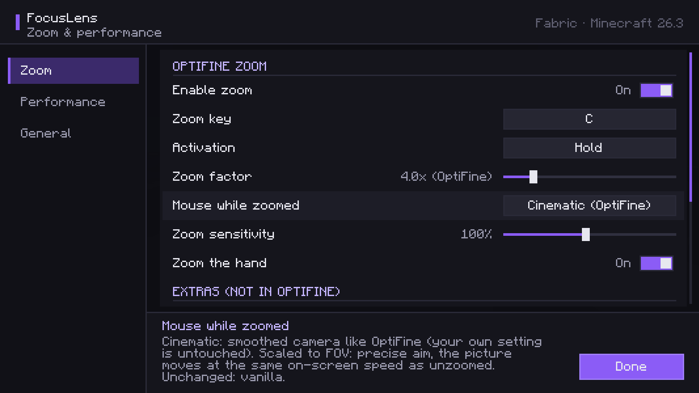
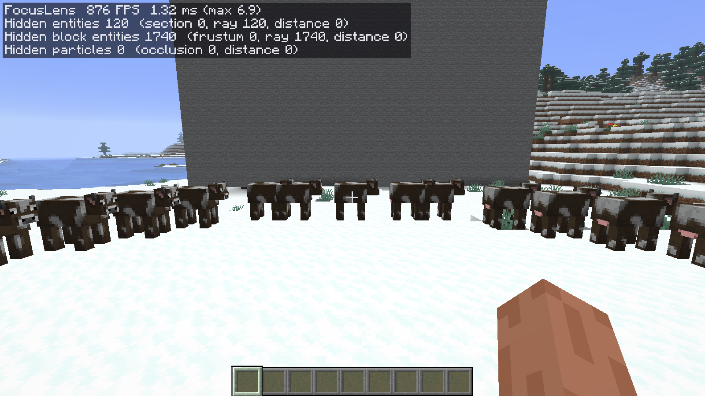
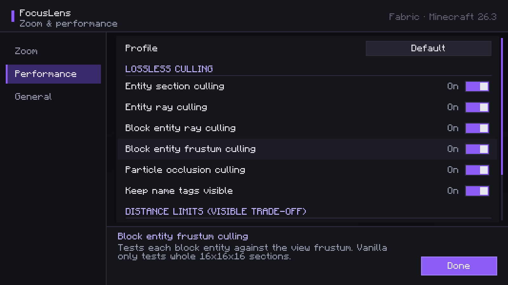

# FocusLens

**OptiFine-style zoom and measurable client-side rendering optimizations for Fabric and NeoForge.**

FocusLens is a fully client-side mod. It works in singleplayer, on any multiplayer server and on Realms
without being installed on the server.

* **Zoom** that behaves like OptiFine's: hold **C**, the field of view is divided by 4 after all vanilla
  FOV effects, the cinematic camera smooths the mouse while zoomed, and everything returns to exactly how
  it was when you let go. Toggle mode, other zoom factors, scroll-wheel zoom and animation are optional.
* **Culling** of entities, block entities and particles that cannot be seen, using vanilla's own
  cave-culling graph and an asynchronous ray test — work vanilla 26.x does not do.
* **Built-in benchmark** that compares FocusLens OFF vs ON in the same session on a fixed camera path and
  saves average FPS, 1% lows and frame-time percentiles.



<sub>All images are real in-game screenshots taken by the automated test run.</sub>

## Supported versions

| Minecraft | Fabric | NeoForge | Built | Tested in game |
|---|---|---|---|---|
| 26.3 | Fabric Loader ≥ 0.19.5, Fabric API 0.165.0+26.3 | 26.3.0.100+ | ✅ | ✅ both loaders: zoom, culling, benchmarks, pixel comparison |
| 26.2 | Fabric Loader ≥ 0.19.5, Fabric API 0.161.0+26.2 | 26.2.0.93+ | ✅ | ✅ both loaders: smoke test + mixin check |
| 26.1.2 | Fabric Loader ≥ 0.19.5, Fabric API 0.155.3+26.1.2 | 26.1.2.125+ | ✅ | ✅ both loaders: smoke test + mixin check |
| 26.1, 26.1.1 | same Fabric jar as 26.1.2 (declared `>=26.1 <26.2`) | – (NeoForge has no stable build) | – | ❌ not tested |

Each Minecraft version has its own jar (`focuslens-<loader>-<version>+mc<minecraft>.jar`). Java 25 is required
(the same Java Minecraft 26.x itself needs).

## Installation

**Fabric:** install [Fabric Loader](https://fabricmc.net/use/) and
[Fabric API](https://modrinth.com/mod/fabric-api) for your Minecraft version, then put
`focuslens-fabric-…+mc<version>.jar` into `.minecraft/mods`. [Mod Menu](https://modrinth.com/mod/modmenu)
is optional and gives access to the settings from the mod list.

**NeoForge:** install [NeoForge](https://neoforged.net/) for your Minecraft version and put
`focuslens-neoforge-…+mc<version>.jar` into `.minecraft/mods`.

Nothing has to be installed on servers.

## Zoom

| | Default (= OptiFine) |
|---|---|
| Key | **C** (change it in FocusLens settings or in *Controls → Key Binds → FocusLens*) |
| Activation | hold the key; no zoom while a screen is open |
| Strength | field of view ÷ 4, applied after sprinting/speed/fluid/death FOV effects |
| Mouse | cinematic camera while zoomed; your own cinematic setting is never changed |
| Animation | none (instant) |
| Hand | zoomed together with the world |

Optional, all off by default: toggle mode, zoom factor 1.5×–16×, scroll-wheel zoom (×1.2 per notch up to
50×), smooth animation, "Scaled to FOV" precise aiming, sensitivity multiplier, keep the hand unzoomed.

How the behaviour was derived and how it is implemented: [docs/TECHNICAL-ANALYSIS.md](docs/TECHNICAL-ANALYSIS.md#2-the-optifine-zoom).

## Performance optimizations

What vanilla 26.x already does well (terrain section culling, async chunk building, retained-mode GUI,
AFK/minimized FPS limits) is left alone. FocusLens fills the gaps found in the 26.x render code:

| Optimization | What it removes | Visual change |
|---|---|---|
| Entity section culling | Entities in sections that vanilla's occlusion graph proved invisible (vanilla uses this graph for terrain and block entities but not for entities). | None |
| Entity ray culling | Entities fully hidden behind opaque blocks, tested on a background thread. | None (results one frame behind the camera) |
| Block entity ray culling | Chests, signs, banners, skulls, shulker boxes, … hidden behind opaque blocks. | None (one frame behind) |
| Block entity frustum culling (Fabric) | Block entities outside the screen in partially visible sections. NeoForge already does this. | None |
| Particle occlusion culling | Particles in sections proven invisible. | None |
| Distance limits (Balanced/Performance profiles) | Far block entities, decorative entities, particles. | Yes, by design |

Safety rules: players and entities with visible name tags, glowing entities, leashed entities, the camera
entity, very large entities and off-screen-rendered block entities (beacon beams) are never culled; culling
pauses during Iris shadow passes; anything uncertain is drawn. Details:
[docs/TECHNICAL-ANALYSIS.md](docs/TECHNICAL-ANALYSIS.md#5-what-focuslens-implements-and-why).

Gains depend on the scene: if nothing is hidden behind terrain or walls, there is nothing to cull and FPS
stays the same. The performance overlay (*General → Performance overlay*) shows how many objects each
optimization removed in the last frame.

## Measured results

On the test machine (Ryzen 7 7700X, RTX 4080, 1600×900, render distance 16), Minecraft 26.3, comparing
FocusLens OFF and ON in the same session:

| Scene | Loader | Average FPS | 1% low FPS |
|---|---|---|---|
| Storage base: 1,800 chests, 1,800 signs, 240 mobs hidden behind walls | Fabric | 340 → 963 (+183%) | 141 → 395 |
| same, second session | Fabric | 434 → 1515 (+249%) | 168 → 505 |
| same | NeoForge | 535 → 1057 (+98%) | 146 → 363 |
| Nothing hidden (overhead test) | Fabric | 1760 → 1773 (+0.8%, noise) | – |

OFF and ON screenshots of the same views are pixel-identical (0 differing pixels), so these gains come
without visible changes. Gains depend on how much is hidden in your world; with nothing hidden they are zero.
Full report, method and raw data: [docs/TEST-REPORT.md](docs/TEST-REPORT.md).



## Settings

Open them with the **FocusLens...** button in *Options → Video Settings*, from Mod Menu / the NeoForge mod
list, or with an optional key. Three sections: **Zoom**, **Performance** (profiles Default / Balanced /
Performance and every optimization individually) and **General** (overlay, keys, benchmark, compatibility
status). Every setting is explained in the screen and in [docs/SETTINGS.md](docs/SETTINGS.md).
Settings are stored in `config/focuslens.json`.



## Benchmark

*Settings → General → Compare OFF vs ON* (or the optional *Benchmark* key) runs four passes — FocusLens
optimizations OFF, ON, OFF, ON — each on the same fixed camera path, and prints the result in chat. Full
data is written to `.minecraft/focuslens/benchmarks/`. Method and definitions: [docs/BENCHMARKING.md](docs/BENCHMARKING.md).

## Compatibility

| Mod | Status |
|---|---|
| Sodium | Compatible. Sodium's own section culling replaces FocusLens' section-graph features; ray culling and zoom stay active. |
| Iris / shader packs | Compatible. Culling pauses during the shadow pass so shadows of hidden entities stay correct. |
| Entity Culling | Compatible. FocusLens turns its own ray culling off to avoid duplicate work. |
| ImmediatelyFast, Lithium, FerriteCore | No overlap; can be used together. |
| Zoomify, Ok Zoomer, Logical Zoom and other zoom mods | Detected; FocusLens' zoom key starts unbound so the two zooms do not fight over C. |
| OptiFine (OptiFabric) | Not supported (declared as conflict on Fabric). |

FocusLens uses only MixinExtras injectors that chain with other mods (`@ModifyReturnValue`,
`@ModifyExpressionValue`, `@WrapOperation`, `@Inject`); no `@Overwrite` and no `@Redirect`.

## Known limitations

* Ray-culling results lag the camera by about one frame: turning very quickly around a corner can show an
  entity or block entity one frame late. Results are dropped when the camera moves more than 0.75 blocks.
* Block entity ray culling assumes block-entity models stay within about one block of their block (true for
  all vanilla block entities). A modded block entity that draws far outside its block without declaring
  "render off screen" could be culled too early — turn *Block entity ray culling* off if that happens.
* Section-graph features are inactive with Sodium (by design, see above).
* The benchmark's OFF passes run with FocusLens installed but suspended; a "not installed at all" baseline
  needs an external frame-time tool.

## Test status

Built and unit-tested for 26.1.2, 26.2 and 26.3; every loader/version combination was started as a real
client, joined a world and passed a check that all FocusLens mixins are applied. The zoom (FOV ÷ 4,
cinematic camera, full restore) was verified in game on 26.3 for both loaders. **Not tested:** 26.1/26.1.1,
live multiplayer servers and Realms (FocusLens has no server-side or network code), and actual combinations
with Sodium, Iris, Entity Culling or other zoom mods (their handling is based on code analysis). Details:
[docs/TEST-REPORT.md](docs/TEST-REPORT.md).

## Building from source

Requires JDK 25.

```bash
./gradlew build -Pmc=26.3
```

`-Pmc` selects the Minecraft version (`26.1.2`, `26.2`, `26.3`; default `26.3`). Jars are written to
`fabric/build/libs` and `neoforge/build/libs`. Per-version values (loader versions, pack format, source
overlays) live in `versions/<mc>.properties`; version-specific code lives in `common/src/mc26_x/java`.

Project layout:

```
common/     shared code: zoom, culling, benchmark, config, GUI, mixins (no loader imports)
  src/main/       code for every supported Minecraft version
  src/mc26_1|2|3  the few classes whose Minecraft calls differ per version (McCompat)
fabric/     Fabric entrypoint, platform services, Mod Menu integration
neoforge/   NeoForge entrypoint, platform services
versions/   one properties file per supported Minecraft version
tools/bench reproducible benchmark world + client options
```

## License

[MIT](LICENSE). FocusLens contains no code from OptiFine or from the performance mods it is compared with;
see [docs/TECHNICAL-ANALYSIS.md](docs/TECHNICAL-ANALYSIS.md#4-existing-performance-mods) for their licenses.
