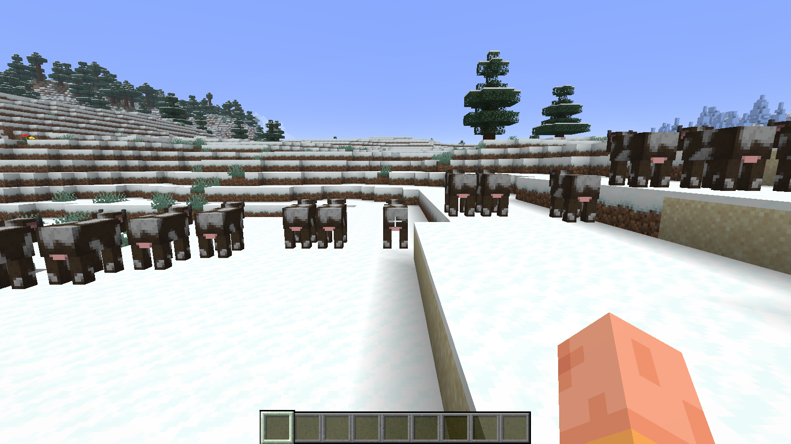
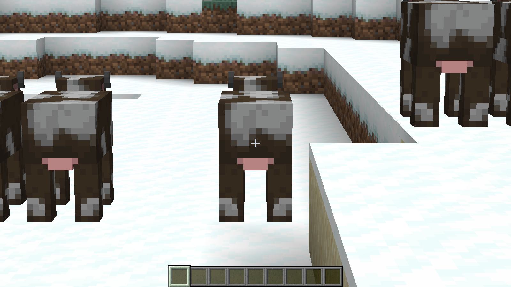
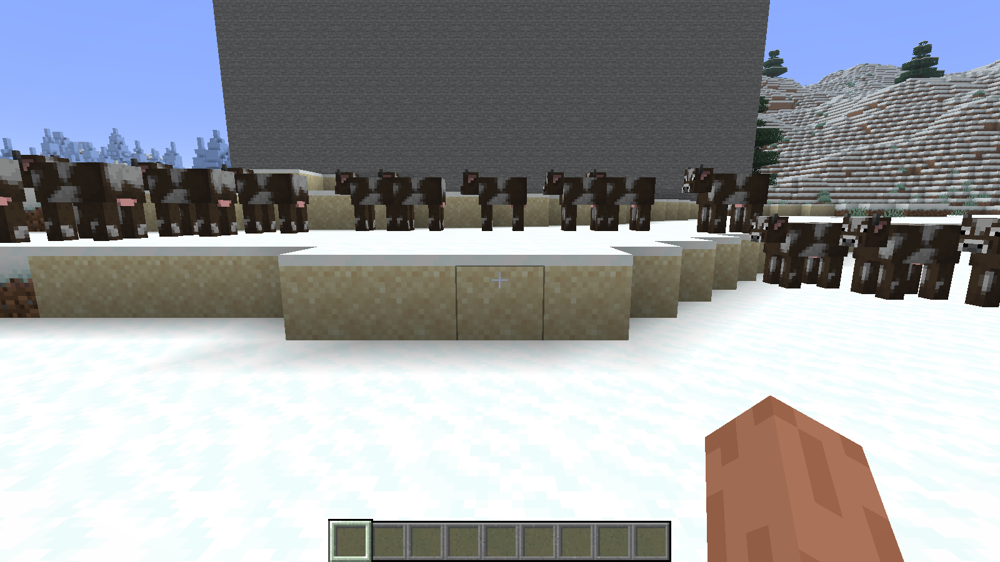

# Test report

Everything below was actually run on 2026-10-31. Nothing is estimated or extrapolated; where something was
not tested, it says so.

## Test machine

| | |
|---|---|
| CPU | AMD Ryzen 7 7700X (8 cores / 16 threads) |
| GPU | NVIDIA GeForce RTX 4080, driver 617.42, OpenGL backend |
| OS | Windows 11 Pro (10.0.26200) |
| Java | Eclipse Temurin 25.0.5 |
| Window | 1600×900, VSync off, FPS unlimited, render distance 16, simulation distance 8, clouds off |

## Build matrix

`./gradlew build -Pmc=<version>` (clean compile of common + Fabric + NeoForge, 21 unit tests):

| Minecraft | common | Fabric jar | NeoForge jar | Unit tests |
|---|---|---|---|---|
| 26.3 | ✅ | ✅ | ✅ | 21/21 ✅ |
| 26.2 | ✅ | ✅ | ✅ | 21/21 ✅ |
| 26.1.2 | ✅ | ✅ | ✅ | 21/21 ✅ |

Unit tests cover the voxel ray traversal (walls, gaps, negative coordinates, start/target voxels, box
visibility), frame statistics (1% low definition, percentiles), zoom math (frame-rate independent easing,
screen-space sensitivity, scroll clamping) and config validation (clamping, unknown enums, profiles).

## In-game runs

### Runtime matrix

Every combination was started as a real game client (`runClient`), joined a singleplayer world and ran the
benchmark; a crash or a failed mixin would have stopped it (all injectors use `require = 1`).

| Minecraft | Loader | Boots & joins world | Benchmark ran | Entities culled | Block entities culled | Mixin audit¹ |
|---|---|---|---|---|---|---|
| 26.3 | Fabric | ✅ | ✅ 6 runs | ✅ | ✅ | ✅ 8/8 |
| 26.3 | NeoForge | ✅ | ✅ 2 runs | ✅ | ✅ (after fix, see below) | ✅ 8/8 |
| 26.2 | Fabric | ✅ | ✅ smoke (10 s) | ✅ | – (no block entities in view) | ✅ 8/8 |
| 26.2 | NeoForge | ✅ | ✅ smoke (10 s) | ✅ | – | ✅ 8/8 |
| 26.1.2 | Fabric | ✅ | ✅ smoke (10 s) | ✅ | – | ✅ 8/8 |
| 26.1.2 | NeoForge | ✅ | ✅ smoke (10 s) | ✅ | – | ✅ 8/8 |

¹ `-PmixinAudit` runs Mixin's own `MixinEnvironment.audit()` and then, independent of the loader, loads each of
the 8 classes FocusLens patches (`Camera`, `MouseHandler`, `Minecraft`, `EntityRenderDispatcher`,
`BlockEntityRenderDispatcher`, `QuadParticleGroup`, `Entity`, `BlockEntity`) and checks that FocusLens' handler
methods are present in each. This also covers classes that are normally loaded only when particles appear.

26.1 and 26.1.1 were not run; they share Fabric API and the code base of 26.1.2, but are untested.
Multiplayer servers and Realms were not tested live. FocusLens sends no packets and changes nothing
server-side (all hooks are in client rendering and input code), so there is nothing server-dependent.
Sodium, Iris, Entity Culling and other mods were not installed during testing; their handling is based on
code analysis only (see [TECHNICAL-ANALYSIS.md](TECHNICAL-ANALYSIS.md)).

### Zoom (Minecraft 26.3, Fabric and NeoForge)

The zoom key was held programmatically during the `-PdocScreenshots` run and the real camera state was logged:

| State | Camera FOV | FOV option | Cinematic option | Cinematic applied |
|---|---|---|---|---|
| Before | 70.00 | 70 | false | false |
| Zoom key held | **17.50** (= 70 ÷ 4) | 70 | false | **true** |
| After release | 70.00 | 70 | false | false |

Identical on both loaders: the FOV is divided by exactly 4, the cinematic camera is applied only while
zoomed, and neither the FOV option nor the cinematic-camera option is ever modified.

| Normal | Zoom held |
|---|---|
|  |  |

Not verified in game (code review and unit tests only): toggle mode, scroll zoom, zoom animation, the
"Scaled to FOV" mode, behaviour with Speed/Slowness effects.

### Visual correctness of the culling

With `-PdocScreenshots` the same four views (south, west, north, east; static scene, clouds off) were captured
with all optimizations suspended and active, three seconds apart, and compared pixel by pixel
(`tools/bench/compare_screenshots.py`, tolerance 12/255 per channel):

| Loader | South | West | North | East |
|---|---|---|---|---|
| Fabric 26.3 | 0 px | 0 px | 0 px | 0 px |
| NeoForge 26.3 | 0 px | 0 px | 0 px | 0 px |

The OFF and ON images are identical while, in the same scene, the benchmark shows FocusLens hiding about
50 entities and 1,300–1,360 block entities per frame. (With clouds on, 0.2–0.75% of pixels differed — only at
cloud edges, because clouds drift in real time between the two captures.)

| OFF | ON |
|---|---|
|  |  |

### Benchmarks (Minecraft 26.3)

Method: [BENCHMARKING.md](BENCHMARKING.md). Four 30 s passes per run (OFF, ON, OFF, ON) on a fixed camera
path (one full turn), each after 4 s settle time. Raw summaries: [benchmarks/](benchmarks/).

**Scene "structures"**: a sealed bunker and an open-topped walled courtyard next to spawn, together 1,800 chests,
1,800 signs and 240 motionless mobs, none visible from spawn; 40 visible cows around the player.

| Run | Loader | Avg FPS OFF → ON | 1% low OFF → ON | P99 frame time OFF → ON | Hidden per frame (ON) |
|---|---|---|---|---|---|
| 1 | Fabric | 340.5 → 962.8 (**+183%**) | 141.1 → 394.8 (+180%) | 5.66 → 2.30 ms | 49 entities, ~586 block entities by frustum, ~771 by ray |
| 2 | Fabric | 434.0 → 1514.9 (**+249%**) | 167.5 → 504.9 (+201%) | 5.03 → 1.77 ms | 48 entities, 592 frustum, ~766 ray |
| 3 | NeoForge | 534.7 → 1057.0 (**+98%**) | 145.6 → 363.1 (+149%) | 5.35 → 2.27 ms | 53 entities, ~1,298 by ray² |

² NeoForge already tests each block entity against the frustum itself, so its OFF baseline is higher and only
FocusLens' ray culling adds to it.

Runs 1 and 2 are separate game sessions on the same machine. Their absolute numbers differ by ~25–55%
(GPU clocks, background load), while each run's own OFF/ON pairs agree within a few percent — which is why
only OFF/ON passes from the same session are compared. The first pass of every run (always OFF) includes a
one-time warm-up hitch (max frame time 130–150 ms), which mainly lowers OFF's 0.1% lows; average FPS and 1%
lows of the second OFF/ON pair alone show the same picture (run 1: 346 → 980 FPS, 1% low 163 → 412).

**Scene "empty"** (same world preparation, only the 40 visible cows; measures FocusLens' cost when there is
nothing to cull):

| Loader | Avg FPS OFF → ON | 1% low, second pair only |
|---|---|---|
| Fabric | 1759.6 → 1773.4 (+0.8%) | 801.1 → 816.5 |

No measurable overhead: the difference is within run-to-run noise.

**What these numbers mean.** The structures scene was built so that a lot of content is hidden behind walls —
a large storage base. In such scenes FocusLens removes most of the block-entity and entity work and the frame
rate rises sharply. In scenes with nothing hidden (open landscape, few entities) the gain is around zero.
Real-world results lie between the two and depend on the world.

### Bugs found by testing and fixed

| Found by | Problem | Fix |
|---|---|---|
| First NeoForge benchmark: "block entities culled: 0" | NeoForge has two `tryExtractRenderState` overloads; a name-only mixin selector picked the deprecated one the game never calls. | Loader-specific mixins; NeoForge selects the overload by descriptor. Verified: 1,298/frame culled. |
| NeoForge automated run stuck | `logoFile` in `neoforge.mods.toml` is deprecated; NeoForge shows a blocking warning screen. | Use `iconFile`. |
| First benchmark scene | Hidden room 80 blocks below the camera was already removed by vanilla's frustum: nothing to measure. | Scene rebuilt at surface level. |
| Code review during testing | Vanilla caps FPS at 30 after 60 s without input, which would have ruined long benchmark runs. | The benchmark counts as input. |
| Screenshot review | Long setting descriptions overflowed the footer. | Wrapped text with a line limit, shorter descriptions. |
| Code review | Block entities beyond their renderer's view distance were still sent to the ray thread. | Pre-check with the renderer's own `shouldRender`. |
